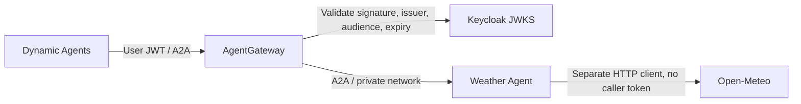

# Sample A2A agents

Standalone examples for [CAIPE remote A2A tools](https://github.com/caipe-io/ai-platform-engineering/pull/2373), using the official **`a2a-sdk==1.2.2`** and A2A 1.0 JSON-RPC.

| Agent | Tools | Access |
| --- | --- | --- |
| Netutils | Existing Netutils MCP server | Direct A2A endpoint |
| Weather | Open-Meteo current weather and three-day forecasts | AgentGateway validates the user's Keycloak JWT |

Both advertise streaming and emit incremental text artifacts. Blocking clients receive the completed result. The shared LangGraph adapter, tests, Docker image, and gateway configuration live here; the platform repository contains the remote-agent registry, client, authentication selection, and UI.

## Start alongside CAIPE

1. Start CAIPE with Keycloak, UI, Dynamic Agents, and the Netutils MCP service. The `rbac`, `dynamic-agents`, `caipe-ui` (or `caipe-ui-prod`), `caipe-mongodb`, and `mcp-servers` profiles provide these services. Complete Keycloak initialization before starting the Weather gateway.
2. Clone and configure these examples:

   ```bash
   git clone https://github.com/caipe-io/sample_a2a_agents.git
   cd sample_a2a_agents
   cp .env.example .env
   docker network ls
   ```

3. Edit `.env`:
   - Set `CAIPE_NETWORK` to the running platform's Docker network (for example `caipe_default`).
   - Set `OPENAI_MODEL_NAME` and `OPENAI_API_KEY`. For LiteLLM, set `OPENAI_BASE_URL` to its OpenAI-compatible URL ending in `/v1`.
   - Set `NETUTILS_MCP_URL` if your MCP service uses a different name or port.
   - Configure different loopback host ports with `NETUTILS_HOST_PORT` / `WEATHER_GATEWAY_HOST_PORT` if needed.
4. Review `deploy/agentgateway/config.a2a-weather.yaml`:
   - `issuer` must exactly match the browser-facing Keycloak issuer in the user's JWT, including scheme, port and realm.
   - `jwks.url` must reach Keycloak from the gateway container. The default uses Docker DNS `keycloak:7080`.
   - `audiences` must include an audience in the user's token.
   - Set `WEATHER_GATEWAY_CONFIG` to a local copy if you customize the file.
5. Start either or both examples:

   ```bash
   docker compose --profile netutils --profile weather up -d --build
   docker compose --profile netutils --profile weather ps
   ```

The samples use their own image and do not import or install the Dynamic Agents runtime. Model configuration supports OpenAI-compatible endpoints; weather needs outbound HTTPS but no weather API key. Netutils requires the external MCP service to be ready before startup.

## Register in Agent Builder

In **Hello World → Advanced → Remote A2A Agents**, add:

| Name | URL from Dynamic Agents | Authentication | Timeout |
| --- | --- | --- | --- |
| Netutils Agent | `http://netutils-agent:8120/` | User JWT, `Authorization` | 120 seconds |
| Weather Agent | `http://weather-agentgateway:4000/` | User JWT, `Authorization` | 120 seconds |

- Discover each Agent Card, **Add and select**, then **Save Changes** on the parent agent.
- Enable **Stream responses** per entry to see remote text in the running tool panel.
- Try: “Use Weather Agent for the current weather and forecast in my city, and Netutils Agent to resolve example.com.” Include a city.
- Select entries for subagents in the same way. Each selected endpoint becomes a callable tool.
- A host-run Dynamic Agents process needs `http://localhost:8120/` and `http://localhost:4010/` instead. Also change `NETUTILS_AGENT_URL` / `WEATHER_AGENT_URL` to those URLs, since the SDK follows the advertised Agent Card interface.

## Weather authentication boundary



- Discovery and A2A calls require a valid JWT; missing/invalid tokens return **401**.
- Weather has no published host port and joins only its private backend network. Its Agent Card advertises the gateway URL.
- AgentGateway consumes `Authorization` after validation. This sample provides JWT authentication; it does not configure OpenFGA authorization.
- AgentGateway v1.1.0 native A2A card rewriting expects the legacy `url` field. This configuration proxies HTTP unchanged under the JWT policy, preserving A2A 1.0 `supportedInterfaces` and SSE streaming.
- Netutils demonstrates direct connectivity. Its endpoint does not validate the forwarded JWT; use a gateway for protected deployments.

## Run without Docker

Python 3.14 and `uv` are required. With `.env` configured:

```bash
uv sync --locked
uv run --env-file .env uvicorn sample_a2a_agents.netutils_agent.server:app --host 127.0.0.1 --port 8120
```

Run Weather with `sample_a2a_agents.weather_agent.server:app` on port 8121. Set advertised URLs to reachable endpoints; use Compose for the private-network JWT gateway example.

## Checks

```bash
uv run ruff check
uv run pytest -q
SAMPLE_ENV_FILE=.env.example docker compose --env-file .env.example --profile netutils --profile weather config --quiet
docker build -t sample-a2a-agents:local .
```

Tests use injected fake agents and mocked provider responses, without model keys or live weather requests. They cover SDK discovery, blocking and streaming calls, progressive artifacts, weather errors, credential isolation from the provider, and the gateway/private-network configuration.

## Contributing

- Use conventional commit titles and a human-provided DCO sign-off on every commit.
- Run the checks above; do not commit `.env`, credentials, or generated environments.
- These examples were extracted from `caipe-io/ai-platform-engineering` PR #2373. AI assistance was used for implementation and verification.

Licensed under Apache-2.0; see [LICENSE](LICENSE).
